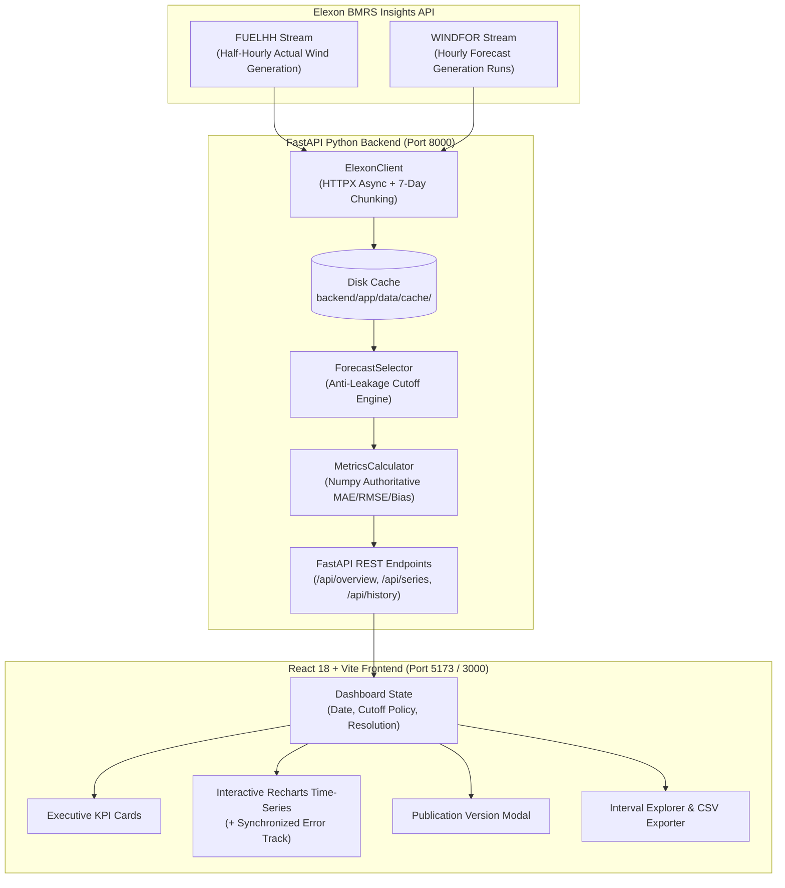

# UK Wind Forecast Accuracy & Day-Ahead Energy Procurement Dashboard

An enterprise decision-support analytics dashboard built for UK energy utilities, commercial trading desks, and power procurement analysts. The system evaluates day-ahead national wind generation forecast accuracy against actual delivered generation using official Elexon Balancing Mechanism Reporting Service (BMRS) data streams for January 2026.

---

## 1. Executive Summary & Business Context

In the Great Britain (GB) wholesale electricity market, commercial utilities must purchase power on the Day-Ahead market (via auctions on EPEX SPOT and Nord Pool) to balance anticipated consumer electricity demand against generation assets. 

Because wind output is weather-dependent and volatile:
- **Overforecasting** causes a utility to buy too little market power, leaving an unhedged short position that faces punitive System Buy Cash-Out prices during system stress.
- **Underforecasting** causes a utility to over-procure wholesale contracts, incurring imbalance spill penalties when disposing of surplus power in the Balancing Mechanism.

### The Critical Timing Rule: Zero Look-Ahead Bias
The UK Day-Ahead wholesale power auction order book closes strictly at **11:00 AM UK Local Time on Day D-1** (with secondary gates at 12:00 and 17:00). 

Evaluating a day-ahead procurement decision using a forecast published after this cutoff is a severe error known as **look-ahead bias** (data leakage). This application guarantees mathematical auditability by strictly filtering forecast runs published at or before the decision cutoff.

---

## 2. Key Capabilities

- **January 2026 Focus Horizon**: Complete dataset covering all 744 hours (or 1,488 half-hour settlement periods) of January 2026.
- **Official Elexon Datasets Only**: Powered solely by Elexon BMRS `FUELHH` (WIND actuals) and `WINDFOR` (forecasts). Zero third-party weather or synthetic datasets.
- **Configurable Day-Ahead Decision Cutoffs**:
  - `D-1 11:00 UK Time`: EPEX SPOT / Nord Pool UK Day-Ahead Auction close (Default).
  - `D-1 12:00 UK Time`: Standard European noon day-ahead gate closure.
  - `D-1 17:00 UK Time`: Post-clearing bilateral trading gate.
  - `Intraday H-4`: 4-hour pre-delivery rolling gate.
  - `Intraday H-1`: Elexon Gate Closure (1 hour before physical delivery).
  - `Custom`: User-specified cutoff timestamp.
- **Interactive Multi-Series Recharts Visualization**:
  - Actual generation (FUELHH) vs Selected Day-Ahead forecast (WINDFOR).
  - Synchronized error track distinguishing Overforecasting (+MW in Amber) from Underforecasting (-MW in Rose).
  - Timeline zoom and pan brush.
- **Forecast Publication Run History Inspector**: Click any interval to audit all 20+ historical forecast runs published by NESO, verifying pre-cutoff eligibility and disqualified post-cutoff runs.
- **Authoritative Python Analytics**: MAE, RMSE, Signed Bias, and MAPE strictly computed across identical matched interval pairs.
- **Interval Data Explorer & Export**: Interactive table with multi-column sorting, pagination, search, and instant CSV export.
- **Resilient Fallback Mode**: If upstream Elexon endpoints experience rate-limiting or network outage, the system gracefully loads deterministic fallback data clearly badged as demo mode (never disguising synthetic data as live data).

---

## 3. Architecture & Data Flow



---

## 4. Directory & File Structure

```
wind-forecast-dashboard/
├── backend/
│   ├── app/
│   │   ├── main.py                     # FastAPI application entrypoint & CORS config
│   │   ├── api/
│   │   │   └── routes.py               # REST API endpoints (/overview, /series, /history, /export)
│   │   ├── core/
│   │   │   └── config.py               # Pydantic environment settings and Elexon endpoints
│   │   ├── services/
│   │   │   ├── elexon_client.py        # HTTPX client with retries and 7-day query chunking
│   │   │   ├── forecast_selector.py    # Core leak-free cutoff matching engine
│   │   │   ├── metrics_calculator.py   # Authoritative numpy statistical calculations
│   │   │   └── data_manager.py         # Disk cache and fallback demo orchestration
│   │   ├── schemas/
│   │   │   └── models.py               # Strict Pydantic models and response schemas
│   │   └── data/
│   │       ├── cache/                  # Cached verified January 2026 Elexon records
│   │       └── demo/                   # Offline deterministic sample fallback files
│   ├── tests/
│   │   ├── test_forecast_selector.py   # Unit tests for cutoffs, edge cases, timezones, duplicates
│   │   ├── test_metrics_calculator.py  # Unit tests verifying hand-calculated benchmarks
│   │   └── test_api_routes.py          # FastAPI testclient integration tests
│   ├── Dockerfile                      # Production Python 3.11-slim container
│   └── requirements.txt                # Python backend dependencies
├── frontend/
│   ├── src/
│   │   ├── components/
│   │   │   ├── Header.tsx              # Date picker, cutoff selector, resolution toggle, export
│   │   │   ├── KpiCards.tsx            # KPI metric cards (Actual, Forecast, Bias, MAE, RMSE)
│   │   │   ├── ForecastChart.tsx       # Recharts actual vs forecast lines + error bars
│   │   │   ├── AccuracySummary.tsx     # Explanatory market risk & bias interpretation cards
│   │   │   ├── PublicationHistoryModal.tsx # Historical forecast run timeline & inspector
│   │   │   └── DataTable.tsx           # Sortable, paginated interval table with CSV download
│   │   ├── services/
│   │   │   └── api.ts                  # Typed client for backend REST API
│   │   ├── types/
│   │   │   └── index.ts                # TypeScript interfaces matching backend models
│   │   ├── test/
│   │   │   ├── setup.ts                # Vitest DOM setup
│   │   │   ├── KpiCards.test.tsx       # Component tests for KPI rendering
│   │   │   └── Header.test.tsx         # Component tests for controls and export
│   │   ├── App.tsx                     # Main dashboard container
│   │   ├── main.tsx                    # React DOM entrypoint
│   │   └── index.css                   # Tailwind CSS styling and theme
│   ├── Dockerfile                      # Multi-stage build + Nginx production container
│   ├── nginx.conf                      # Nginx reverse proxy configuration
│   ├── package.json                    # Frontend dependencies
│   ├── vite.config.ts                  # Vite build and proxy configuration
│   └── tailwind.config.js              # Enterprise dark navy theme configuration
├── docker-compose.yml                  # Unified multi-container local stack
├── render.yaml                         # Production Render backend deployment specification
├── vercel.json                         # Production Vercel frontend deployment specification
├── .env.example                        # Reference environment variables
├── .gitignore                          # Clean repository rules
├── DEMO_SCRIPT.md                      # 10-Minute YouTube video recording presentation script
└── README.md                           # Comprehensive documentation
```

---

## 5. Elexon Data Sources & Processing Pipeline

### 1. Actual Generation (`FUELHH`)
- **API Endpoint**: `https://data.elexon.co.uk/bmrs/api/v1/datasets/FUELHH/stream`
- **Query Filter**: `settlementDateFrom=2026-01-01&settlementDateTo=2026-01-31`
- **Fuel Filter**: `fuelType == 'WIND'`
- **Temporal Resolution**: Half-hourly (48 settlement periods per day, starting on :00 and :30).
- **Units**: Megawatts (MW).

### 2. Forecast Generation (`WINDFOR`)
- **API Endpoint**: `https://data.elexon.co.uk/bmrs/api/v1/datasets/WINDFOR/stream`
- **Query Filter**: `publishDateTimeFrom` and `publishDateTimeTo` (queried in 7-day batches from 2025-12-28 through 2026-02-01).
- **Target Filter**: Delivery intervals where `startTime` falls within January 2026.
- **Temporal Resolution**: Hourly forecast blocks (starting on :00 of each hour).
- **Publication Frequency**: Issued ~8 to 12 times daily by NESO with lead times up to 72 hours ahead.
- **Units**: Megawatts (MW).

### 3. Resolution Matching (Hourly vs Half-Hourly)
- **Hourly Block Resolution (Default)**: Matches the 24 daily GB day-ahead wholesale market trading slots. Half-hourly FUELHH actuals (:00 and :30) are averaged into the 1-hour block generation, matching the 1-hour WINDFOR forecast.
- **Half-Hourly Resolution**: Displays all 48 settlement periods per day. Hourly WINDFOR forecasts match the :00 half-hour interval, while :30 intervals are transparently identified as missing forecasts without silent interpolation.

---

## 6. Forecast Selection Logic (Zero Look-Ahead Bias)

For any delivery interval $t$ on delivery date $D$:

1. **Calculate Market Cutoff $C(t)$**:
   - For `day_ahead_1100`: $C(t) = \text{Date}(D - 1\text{ day}) \text{ at 11:00:00 Europe/London Time}$.
   - Converted to timezone-aware UTC to prevent Daylight Saving Time distortions.
2. **Filter Candidate Forecasts**:
   $$\text{Candidates}(t) = \{ f \in \text{WINDFOR} \mid f.\text{startTime} = t \}$$
3. **Enforce Cutoff Constraint**:
   $$\text{Eligible}(t) = \{ f \in \text{Candidates}(t) \mid f.\text{publishTime} \le C(t) \}$$
4. **Select Latest Pre-Cutoff Run**:
   $$f^*(t) = \operatorname{argmax}_{f \in \text{Eligible}(t)} (f.\text{publishTime})$$
5. If $\text{Eligible}(t) = \emptyset$, then $f^*(t) = \text{None}$ (marked as no eligible forecast pre-cutoff).

**Rule**: Any forecast published after $C(t)$ is strictly excluded from day-ahead evaluation.

---

## 7. Mathematical Accuracy Metrics & Formulas

All authoritative calculations are strictly computed in Python (`backend/app/services/metrics_calculator.py`) using identical matched interval pairs:

### 1. Signed Error (Interval Level)
$$\text{error}_i = \text{forecast}_i - \text{actual}_i$$

### 2. Mean Absolute Error (MAE)
$$\text{MAE} = \frac{1}{N} \sum_{i=1}^N \left| \text{forecast}_i - \text{actual}_i \right|$$
*Represents the average expected magnitude of forecast miss in MW.*

### 3. Root Mean Squared Error (RMSE)
$$\text{RMSE} = \sqrt{\frac{1}{N} \sum_{i=1}^N (\text{forecast}_i - \text{actual}_i)^2}$$
*Penalizes large outlier misses and severe ramp timing errors more heavily than MAE.*

### 4. Forecast Bias (Mean Error)
$$\text{Bias} = \frac{1}{N} \sum_{i=1}^N (\text{forecast}_i - \text{actual}_i)$$
- **Positive Bias ($> 0$)**: Overforecasting. The desk over-predicts wind, procures too little market energy, and faces short imbalance exposure.
- **Negative Bias ($< 0$)**: Underforecasting. The desk under-predicts wind, buys excess power, and must spill surplus power into the Balancing Mechanism.

### 5. Mean Absolute Percentage Error (MAPE)
$$\text{MAPE} = \frac{100\%}{M} \sum_{j \in \{i \mid \text{actual}_i > 10\text{ MW}\}} \frac{\left| \text{forecast}_j - \text{actual}_j \right|}{\text{actual}_j}$$
*Limitation Disclosure*: Excludes periods where actual output $\le 10\text{ MW}$ to avoid numerical distortion from near-zero denominators.

---

## 8. Local Setup & Quickstart

### Prerequisites
- Python 3.11+
- Node.js 18+ and npm 9+
- (Optional) Docker and Docker Compose

### Option A: Local Native Development

#### 1. Start the Backend
```bash
# From repository root
cd backend
python -m pip install -r requirements.txt
python -m uvicorn app.main:app --port 8000 --reload
```
The FastAPI backend starts at `http://localhost:8000`. Interactive API documentation is available at `http://localhost:8000/docs`.

#### 2. Start the Frontend
In a new terminal:
```bash
cd frontend
npm install
npm run dev
```
The Vite development server starts at `http://localhost:5173`. Open your browser to explore the dashboard.

---

### Option B: Docker Compose (Single Command)

```bash
docker compose up --build
```
- Frontend UI: `http://localhost:3000`
- Backend API: `http://localhost:8000`
- Both containers include automated healthchecks.

---

## 9. Automated Testing

### Backend Unit & Integration Tests (Pytest)
```bash
# Run 17 verified tests including hand-calculated benchmarks
python -m pytest backend/tests -v
```
**Test Coverage Includes:**
- Hand-calculated mathematical benchmarks for MAE, RMSE, Bias, and MAPE.
- Multi-version forecast selection under cutoff constraints.
- Edge cases: forecasts published at cutoff, after cutoff, missing actuals, missing forecasts.
- Duplicate record deduplication.
- Europe/London daylight saving transitions (BST to GMT).
- FastAPI endpoints and CSV streaming.

### Frontend Component Tests (Vitest)
```bash
cd frontend
npm run test
```
**Test Coverage Includes:**
- KPI cards rendering exact formatted values and bias indicators.
- Header interaction and CSV export callbacks.

---

## 10. Environment Variables

| Variable | Default Value | Description |
| :--- | :--- | :--- |
| `ELEXON_BASE_URL` | `https://data.elexon.co.uk/bmrs/api/v1` | Official Elexon BMRS Insights API root |
| `API_TIMEOUT_SECONDS` | `30.0` | HTTP client timeout for API requests |
| `MAX_RETRIES` | `3` | Maximum retry attempts with backoff |
| `ENABLE_CACHE` | `true` | Enables local disk caching in `backend/app/data/cache/` |
| `VITE_API_URL` | `/api` | Frontend API proxy path |
| `VITE_BACKEND_URL` | `http://127.0.0.1:8000` | Backend upstream target for local Vite proxy |

---

## 11. Deployment Guide

### Backend Deployment (Render)
1. Fork or push the repository to GitHub.
2. In Render, select **New > Blueprint** and link the repository.
3. Render automatically discovers [`render.yaml`](render.yaml) and provisions the FastAPI Python service.
4. Verify health at `https://<your-render-service>.onrender.com/api/health`.

### Frontend Deployment (Vercel)
1. In Vercel, import the repository.
2. Configure **Root Directory** as `frontend` (or rely on root [`vercel.json`](vercel.json)).
3. Add Environment Variable:
   - `VITE_API_URL`: `https://<your-render-service>.onrender.com/api`
4. Click **Deploy**.

---

## 12. Scope Boundaries & Disclosures

### Energy Scope Disclosure
- **In Scope**: National aggregate wind generation actuals from Elexon BMRS `FUELHH` (`fuelType = WIND`) and national wind generation forecasts from `WINDFOR` for delivery dates in January 2026.
- **Explicitly Out of Scope**: Consumer demand forecasts, system imbalance prices (System Buy Price / System Sell Price), wholesale day-ahead power prices, and thermal generation fleets (CCGT, Nuclear, Coal). This tool evaluates **forecast accuracy** and does not calculate final commercial procurement order volumes.

### AI Tool Disclosure
In accordance with engineering standards, this application was developed and scaffolded with the assistance of **Google Antigravity** advanced agentic coding tools. All data structures, API endpoints, mathematical formulas, and anti-leakage selection policies were verified against official Elexon documentation and validated with automated test suites.
